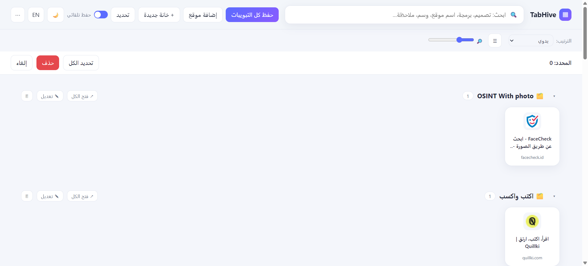
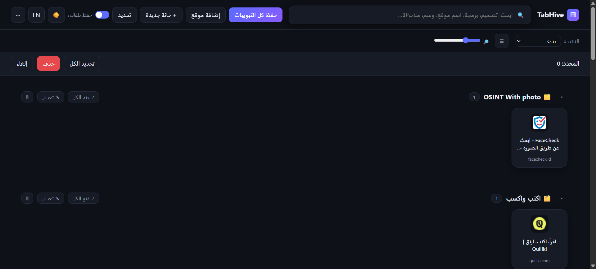

<div align="center">


# TabHive

### تبويباتك فوضى؟ رتّبها مرة واحدة وللأبد.

**احفظ كل تبويب مفتوح، ودَع الإضافة تصنّفه تلقائيًا في مجموعات ذكية، وابحث عن أي موقع بضغطة زر.**
تعمل على Chrome وEdge وBrave وOpera وVivaldi وFirefox. بلا حساب. بلا سحابة. كل شيء محلي.

[](LICENSE)


[**English**](README.md) · [**العربية**](README.ar.md)

</div>

<div dir="rtl">

---

## المشكلة

عندك 47 تبويبًا مفتوحًا. نصفها "هقراه بعدين". وربعها توثيق كنت محتاجه الثلاثاء الماضي. وفي مكان ما بينها مرجع التصميم الذي أقسمت ألا تضيّعه.

ثم يتعطل المتصفح، أو تعيد تشغيل الجهاز، أو تغلق النافذة بالخطأ… ويضيع كل شيء.

والمفضلات لا تحل المشكلة. لا أحد يرتّب المفضلات. تتكدس في مجلد اسمه "New folder (3)" ولا تفتحها ثانية.

## ماذا تفعل TabHive

تحوّل فوضى المتصفح إلى شبكة نظيفة قابلة للبحث من كل المواقع التي تستخدمها، **بشكل تلقائي**.

- تفتح موقعًا ← يُحفظ.
- يذهب إلى المجموعة المناسبة (برمجة، تصميم، ذكاء اصطناعي، تعلّم…) دون أن تحرّك إصبعًا.
- أغلق المتصفح، أعد تشغيل الجهاز، ارجع بعد أسبوع ← كل شيء في مكانه.
- لا شيء يُحذف إلا إذا حذفته **أنت**، وحتى حينها يذهب إلى سلة مع زر تراجع.

اضغط على الأيقونة مرة واحدة فتفتح صفحة سريعة وأنيقة فيها كل مواقعك كمربعات بأيقوناتها، مجمّعة، وقابلة للبحث والسحب.

<!-- ضع لقطات الشاشة في docs/screenshots/ لتظهر هنا -->

<div align="center">

| نهاري | ليلي |
|:--:|:--:|
|  |  |


</div>

---

## ✨ المميزات

### 🧠 تحفظ كل شيء ولا تشغل بالك
- **حفظ كل التبويبات بضغطة واحدة** من كل النوافذ المفتوحة.
- **حفظ تلقائي** (مفعّل افتراضيًا ويمكن إيقافه): أي صفحة تفتحها تُحفظ مرة واحدة بعنوانها الحقيقي، والمكرر يُتجاهل.
- **دائمة**: تبقى بعد إغلاق المتصفح وإعادة تشغيل الجهاز وتحديث الإضافة.
- **لا تحذف شيئًا من تلقاء نفسها.** الحذف يدوي فقط: موقع واحد، أو تحديد عدة مواقع وحذفها معًا.
- **سلة محذوفات + تراجع**: كل حذف يمر بالسلة أولًا. اضغط **تراجع** في الرسالة، أو استرجع لاحقًا. السلة لا تُفرَّغ تلقائيًا أبدًا.

### 🗂️ تنظّم نفسها
- **تصنيف تلقائي** حسب نوع الموقع: برمجة، تصميم، ذكاء اصطناعي، تعلّم، فيديو، موسيقى، تواصل اجتماعي، عمل، تسوق، أخبار. ([كيف تقرر؟](#-كيف-يعمل-التصنيف-التلقائي))
- **مجموعات مخصصة**: غيّر اسم أي مجموعة، وأعطها أيقونة إيموجي ولونًا، أو أنشئ مجموعاتك.
- **اسحب الموقع** من مجموعة إلى أخرى، و**اسحب رأس المجموعة** لإعادة ترتيب المجموعات.
- **صف المفضلة** ⭐: ضع نجمة على موقع (أو أفلته على الصف) ليثبت في الأعلى.
- **الأكثر استخدامًا**: تحسب الإضافة مرات فتح كل موقع، فيعكس الترتيب عاداتك الحقيقية.
- **اقرأ لاحقًا**: مجموعة جاهزة. زر الأيمن على أي موقع ← *اقرأ لاحقًا*.
- **وسوم وملاحظات** لأي موقع، وكلها قابلة للبحث.
- **ترتيب** يدوي، أو الأحدث، أو أبجدي، أو الأكثر استخدامًا.

### 🔍 تجد ما تريد بسرعة
- **شريط بحث فوري** يبحث في العناوين والروابط والملاحظات والوسوم وأسماء المجموعات **وكلمات التصنيف**. اكتب `تصميم` أو `design` فتظهر Figma وCanva وDribbble حتى لو لم تحمل العبارة في عناوينها.
- **نافذة بحث سريع** من **أي** صفحة باختصار لوحة المفاتيح (الافتراضي **Alt+K**). أسهم، Enter، وانتهى.

### ⚡ تضيف المواقع بالجملة وبأي صيغة
- الصق الروابط (رابط في كل سطر) أو نطاقات مجردة.
- **اسحب الروابط وأفلتها** على الصفحة، عدة روابط دفعة واحدة.
- **اسحب مجلدًا كاملًا من الاختصارات** بما فيه المجلدات الفرعية. المدعوم: ملفات Windows `.lnk` (فعلًا، [انظر المحلل](#-كيف-تعمل-من-الداخل))، و`.url` و`.webloc` و`.desktop` و`.txt` وملفات المفضلات المصدَّرة `.html`.
- **استيراد مفضلات المتصفح**: كل مجلد مفضلات يصبح مجموعة بنفس اسمه.
- **زر الأيمن على أي صفحة أو رابط** ← *TabHive: حفظ* / *اقرأ لاحقًا*.

### 🪟 تفتح المواقع كتطبيقات
- **فتح كتطبيق** (⧉): يفتح الموقع في نافذة مستقلة نظيفة بلا شريط تبويبات.
- **اختصار سطح المكتب** (🖥): ينزّل مُشغِّلًا صغيرًا يفتح الموقع بوضع التطبيق في Chrome/Edge. ([التفاصيل بصراحة](#-اختصارات-سطح-المكتب-بصراحة))
- **فتح الكل**: ضغطة واحدة تفتح مجموعة كاملة في الخلفية وتضعها في **مجموعة تبويبات ملونة** باسم المجموعة (متصفحات Chromium).

### 🧹 تحافظ على نظافتها
- **حذف المكررات**: تفهم أن `www.site.com/page` و`site.com/page/?utm_source=x` هي الصفحة نفسها.
- **فحص الروابط المعطلة**: تعلّم المواقع التي صارت تعطي 404/410 أو أخطاء خادم أو لا يمكن الوصول إلى نطاقها. الصلاحية تُطلب فقط عند الضغط على الزر.
- **نسخ احتياطي واستعادة**: صدّر كل شيء إلى JSON، والاستيراد **يدمج** ولا يمسح.

### 🎨 شكلها جميل
- وضع نهاري وليلي (يتبع نظامك في أول تشغيل).
- واجهة كاملة بـ**العربية والإنجليزية** مع دعم **RTL** صحيح.
- شبكة مربعات أو قائمة مضغوطة، ومنزلق لتغيير حجم المربعات.
- لكل موقع أيقونته، وحرف بديل أنيق عند عدم توفرها.

### 🔒 تحمي خصوصيتك
- **قفل أي مجموعة بـ PIN.** المجموعة المقفلة تختفي من الشبكة والمفضلة والبحث والبحث السريع حتى تفتحها. (اقرأ [ملاحظة ما يحميه وما لا يحميه](#-الخصوصية-والصلاحيات).)

---

## 🚀 التثبيت في 60 ثانية

TabHive ليست على المتاجر بعد (انظر [خارطة الطريق](#-خارطة-الطريق))، لذا تُحمَّل مباشرة. يستغرق الأمر دقيقة.

```bash
git clone https://github.com/YOUR_USERNAME/tabhive.git
```

أو نزّل ملف ZIP من GitHub وفكّ ضغطه. المجلد الذي فيه `manifest.json` هو الإضافة.

### Chrome · Edge · Brave · Opera · Vivaldi
1. افتح `chrome://extensions` (أو `edge://extensions` أو `brave://extensions`…).
2. فعّل **وضع المطور (Developer mode)**.
3. اضغط **تحميل غير مضغوط (Load unpacked)** واختر مجلد `tabhive`.
4. ثبّت الأيقونة في شريط الأدوات واضغط عليها. وها أنت داخلها.

### Firefox (الإصدار 128 فأحدث)
1. افتح `about:debugging#/runtime/this-firefox`.
2. اضغط **Load Temporary Add-on…** واختر `manifest.json`.

> **تنبيه:** يزيل Firefox الإضافات المؤقتة عند إعادة تشغيله، فتحتاج لإعادة تحميلها في كل جلسة إلى أن تُوقَّع TabHive وتُنشر. بياناتك المحفوظة تبقى آمنة في الأثناء.

### أول 60 ثانية لك
1. اضغط أيقونة TabHive. تفتح صفحة فيها مواقعك.
2. اضغط **حفظ كل التبويبات** وشاهدها تتوزع على المجموعات.
3. اضغط **Alt+K** من أي صفحة وابحث عن شيء.
4. اسحب موقعًا إلى مجموعة أخرى، واضغط عليه بالزر الأيمن، وضع نجمة على آخر.

> 💡 **قبل التحديث أو إعادة التثبيت:** استخدم **⋯ ← تصدير نسخة احتياطية** أولًا. إزالة إضافة غير مضغوطة من المتصفح قد تمسح بياناتها المخزنة.

---

## 🎯 إضافة المواقع: كل الطرق

| معك… | افعل هذا |
|---|---|
| تبويبات مفتوحة الآن | **حفظ كل التبويبات** (أو اترك الحفظ التلقائي يعمل) |
| رابط | الصقه في **إضافة موقع** أو اسحبه على الصفحة |
| كومة روابط | الصقها رابطًا في كل سطر، أو اسحبها كلها دفعة واحدة |
| مجلد اختصارات | اسحب المجلد كله، أو **إضافة موقع ← اختيار مجلد كامل** |
| ملفات Windows `.lnk` | حدّد الكل (`Ctrl+A`) في المستكشف واسحبها |
| مفضلات المتصفح | **⋯ ← استيراد مفضلات المتصفح** (المجلدات تصبح مجموعات) |
| ملف مفضلات `.html` مصدَّر | اسحب الملف |
| صفحة تقرؤها | زر أيمن ← **TabHive: حفظ** |
| مقال لوقت لاحق | زر أيمن ← **TabHive: اقرأ لاحقًا** |

أفلت الروابط **فوق مجموعة معينة** لتدخل فيها. وإن أفلتها في أي مكان آخر تصنّفها TabHive لك. المكرر يُتجاهل، وتظهر لك رسالة مثل: *"تمت إضافة 38 موقع • 2 مكرر • 1 ملف بلا رابط"*.

---

## ⌨️ اختصارات لوحة المفاتيح والزر الأيمن

| الإجراء | الاختصار |
|---|---|
| نافذة البحث السريع (من أي صفحة) | **Alt+K** (على Mac: **Control+K**) |
| التركيز على شريط البحث (داخل TabHive) | **Ctrl/⌘ + K** |
| التنقل بين نتائج البحث السريع | **↑ / ↓** ثم **Enter** |
| إغلاق البحث السريع | **Esc** |

يمكنك تغيير الاختصار العام من `chrome://extensions/shortcuts`.

**زر الأيمن على مربع موقع**: فتح · فتح كتطبيق · اختصار سطح المكتب · تعديل · مفضلة · اقرأ لاحقًا · حذف.

---

## 🧭 كيف يعمل التصنيف التلقائي

لا ذكاء اصطناعي ولا طلبات شبكة. هو جدول قواعد صغير مقروء داخل [`common.js`](common.js):

1. يقارن **النطاق** بمواقع معروفة (`github.com` و`figma.com` و`youtube.com`…). والنطاقات الفرعية تُطابق أيضًا.
2. إن لم يطابق، يبحث عن **كلمات مفتاحية** في العنوان واسم المضيف (`tutorial` و`design` و`news` ومعها كلمات عربية).
3. وإلا فيذهب إلى **أخرى**.

| التصنيف | أمثلة |
|---|---|
| 💻 برمجة | GitHub, GitLab, Stack Overflow, MDN, LeetCode, CodePen |
| 🎨 تصميم | Figma, Canva, Dribbble, Behance, Unsplash |
| 🤖 ذكاء اصطناعي | ChatGPT, Claude, Perplexity, Hugging Face |
| 🎓 تعلّم | Coursera, Udemy, Khan Academy, Wikipedia |
| 🎬 فيديو | YouTube, Netflix, Twitch |
| 🎵 موسيقى | Spotify, SoundCloud, Anghami |
| 💬 تواصل اجتماعي | Facebook, Instagram, X, LinkedIn, Reddit, Discord |
| 🗂️ عمل | Gmail, Google Docs/Drive, Notion, Trello, Slack |
| 🛒 تسوق | Amazon, eBay, AliExpress, Noon |
| 📰 أخبار | BBC, CNN, Al Jazeera, Reuters |

التصنيف خاطئ؟ اسحب الموقع إلى المجموعة الصحيحة. تريد دعم موقع أو تصنيف؟ تعديل بسطر واحد، انظر [المساهمة](#-المساهمة).

---

## 🖥 اختصارات سطح المكتب: بصراحة

المتصفحات لا تسمح للإضافات بإنشاء اختصار حقيقي على سطح المكتب مباشرة. لذلك يفعل زر 🖥 أقرب شيء ممكن: **ينزّل ملف تشغيل صغيرًا** يفتح الموقع بوضع التطبيق (نافذة مستقلة بلا تبويبات أو شريط عنوان).

| النظام | الملف | ملاحظات |
|---|---|---|
| Windows | `.bat` | يستخدم Chrome (أو Edge إن كان متصفحك). انقله إلى سطح المكتب. |
| macOS | `.command` | نفّذ `chmod +x` عليه مرة واحدة. |
| Linux | `.desktop` | ضعه حيث يتوقعه مشغّل التطبيقات عندك. |

Firefox لا يملك وضع التطبيق، فالمُشغِّل مفيد في متصفحات Chromium فقط. أما زر **⧉ فتح كتطبيق** فيعمل في كل مكان ولا يحتاج ملفًا أصلًا.

---

## 🔐 الخصوصية والصلاحيات

**بياناتك تعيش داخل متصفحك (`storage.local`).** لا حساب، ولا خادم، ولا تحليلات، ولا كود بعيد.

أمران يجب أن تعرفهما بوضوح:

- 🌐 **الأيقونات (Favicons)** تُحمَّل من خدمة الأيقونات في Google (`google.com/s2/favicons`)، أي أن *أسماء نطاقات* مواقعك المحفوظة تُرسل إلى Google لجلب أيقوناتها. إن كان هذا يهمك فانظر خارطة الطريق: تخزين محلي للأيقونات مخطط له.
- 🔒 **قفل PIN ستارة خصوصية وليس تشفيرًا.** يخفي محتوى المجموعة من الواجهة ومن البحث. ومن يستطيع فحص تخزين ملف تعريف متصفحك تقنيًا يمكنه قراءة البيانات. لا تعامله كخزنة.

| الصلاحية | سبب الحاجة إليها |
|---|---|
| `tabs` | قراءة رابط وعنوان التبويبات لحفظها وللتركيز على صفحة الإدارة |
| `storage` | حفظ مواقعك وإعداداتك محليًا |
| `tabGroups` | وضع "فتح الكل" داخل مجموعة تبويبات ملونة |
| `contextMenus` | بنود الزر الأيمن *حفظ* / *اقرأ لاحقًا* |
| `bookmarks` *(اختيارية)* | تُطلب فقط عند الضغط على **استيراد مفضلات المتصفح** |
| الوصول لكل المواقع *(اختيارية)* | تُطلب فقط عند الضغط على **فحص الروابط المعطلة** ليصل الفحص إلى روابطك المحفوظة |

---

## 🌍 دعم المتصفحات

| المتصفح | الحالة |
|---|---|
| Chrome, Edge, Brave, Opera, Vivaldi | ✅ دعم كامل |
| Firefox 128+ | ✅ يعمل. بدون مجموعات تبويبات ملونة ولا مُشغِّل وضع التطبيق، وتثبيت مؤقت حتى النشر |
| Safari | ❌ يحتاج تحويلًا عبر Xcode (لم يُنفَّذ) |

---

## 🛠 كيف تعمل من الداخل

HTML وCSS وJavaScript عادية. **بلا خطوة بناء، ولا إطار عمل، ولا اعتماديات.** افتح المجلد في محررك وابدأ التعديل.

```
tabhive/
├── manifest.json     Manifest V3 (Chromium + Firefox)
├── background.js     عامل الخلفية: الحفظ التلقائي، القوائم السياقية، الاختصار، التبويب الجديد
├── common.js         المنطق المشترك: التصنيف، تطبيع الروابط، التخزين، السلة، البحث، محلل .lnk
├── app.html/css/js   صفحة الإدارة
├── quick.html/js     نافذة البحث السريع (Alt+K)
└── icons/
```

بعض التفاصيل التي أفتخر بها:

- **كتابة آمنة.** كل تعديل يمر عبر طابور قراءة-تعديل-كتابة متسلسل (`mutate()`)، فلا يطمس عامل الخلفية والواجهة حفظ بعضهما.
- **كشف تكرار ذكي.** تُطبَّع الروابط (الأجزاء بعد `#` والشرطة الأخيرة ووسوم التتبع مثل `utm_*` و`fbclid`) قبل المقارنة.
- **محلل `.lnk` حقيقي.** اختصارات Windows صيغة ثنائية ([MS-SHLLINK](https://learn.microsoft.com/en-us/openspecs/windows_protocols/ms-shllink/)). والاختصارات التي ينشئها Chrome للمواقع تخزّن الرابط في حقل *معاملات سطر الأوامر* بترميز UTF-16. تقرأ TabHive أعلام الترويسة، وتتخطى قائمة المعرّفات ومعلومات الرابط، وتفكّ ترميز نصوص البيانات بشكل صحيح، فيعمل إسقاط مجلد كامل من ملفات `.lnk` بسلاسة.
- **بحث يفهم العربية.** يُطبَّع النص (التشكيل وأشكال الألف والياء والتاء المربوطة) فيصير البحث طبيعيًا بالعربية.

---

## ❓ أسئلة شائعة

**هل ستبطّئ متصفحي؟**
الحفظ التلقائي يعمل مرة واحدة عند اكتمال تحميل الصفحة ولا يفعل شيئًا إن كان الرابط محفوظًا. وصفحة الإدارة DOM عادي بلا إطار عمل.

**هل تحفظ تبويبات التصفح الخفي؟**
الإضافات لا تعمل في التصفح الخفي إلا إذا سمحت لها صراحة. وإن سمحت فتعامل مع TabHive كأي إضافة ترى تلك التبويبات.

**حذفت شيئًا بالخطأ.**
**⋯ ← سلة المحذوفات.** كل ما تحذفه يذهب إليها ويبقى حتى تفرغها بنفسك.

**أين تُخزَّن بياناتي؟ وهل أنقلها لجهاز آخر؟**
في التخزين المحلي للإضافة داخل متصفحك. للنقل: **تصدير نسخة احتياطية** على جهاز، و**استيراد** على الآخر. الاستيراد يدمج فلا يُكتب فوق شيء.

**لماذا تختفي الإضافة في Firefox بعد إعادة التشغيل؟**
هذه طبيعة الإضافات المؤقتة. نسخة Firefox الموقّعة ضمن خارطة الطريق.

**هل تتزامن بين الأجهزة؟**
ليس مدمجًا. مساحة مزامنة المتصفح أصغر من أن تتسع لمكتبة حقيقية، والمزامنة السحابية تحتاج حسابات وOAuth وهذا يتعارض مع هدف "بلا حساب". الحل حاليًا: صدّر إلى مجلد تزامنه أصلًا (Drive أو OneDrive أو Dropbox) واستورده على الجهاز الآخر.

---

## 🗺 خارطة الطريق

- [x] حفظ تلقائي ومجموعات ذكية وسحب وإفلات
- [x] بحث، ونافذة بحث سريع، واختصارات
- [x] سلة وتراجع، ونسخ احتياطي، وحذف مكررات، وفحص روابط معطلة
- [x] مفضلة ووسوم وملاحظات واقرأ لاحقًا وقفل PIN
- [x] استيراد بالجملة: مجلدات و`.lnk` و`.url` ومفضلات
- [x] عربية وإنجليزية مع RTL
- [ ] تخزين محلي للأيقونات (بلا طلبات لطرف ثالث)
- [ ] النشر على Chrome Web Store وFirefox Add-ons
- [ ] اختبارات آلية وCI
- [ ] قواعد تصنيف يعرّفها المستخدم
- [ ] تصدير وقفل مشفّران اختياريان
- [ ] لغات واجهة إضافية
- [ ] استيراد من Pocket / Raindrop / OneTab

عندك فكرة؟ [افتح Issue](../../issues). أفضل الأفكار غالبًا تأتي من ألم يومي حقيقي.

---

## 🤝 المساهمة

المساهمات مرحَّب بها جدًا، وبعض أفضلها صغير جدًا:

- **أضف موقعًا إلى تصنيف**: عدّل قائمة النطاقات `d` داخل `CATS` في `common.js`. سطر واحد.
- **أضف كلمات مفتاحية** (بأي لغة) إلى قائمة `k` للتصنيف.
- **ترجم الواجهة**: انسخ كتلة `en` داخل `T` في أعلى `app.js` وترجم النصوص.
- **أصلح خطأ / نفّذ بندًا من خارطة الطريق**: Fork ثم فرع ثم تعديل ثم Pull Request.

دورة التطوير المحلية: حمّل المجلد كإضافة غير مضغوطة، عدّل، واضغط أيقونة إعادة التحميل في `chrome://extensions`. هذا كل شيء.

يرجى إبقاء المشروع بلا اعتماديات، وقصة الخصوصية بسيطة.

---

## 📄 الترخيص

[MIT](LICENSE). استخدمها وانسخها وانشرها.

</div>

---

<div align="center">

**إن أنقذتك TabHive من تبويب ضائع واحد، فنجمة ⭐ تساعد غيرك على اكتشافها.**

صُنعت لأن 47 تبويبًا مفتوحًا ليست نظام تنظيم شخصي.

</div>
