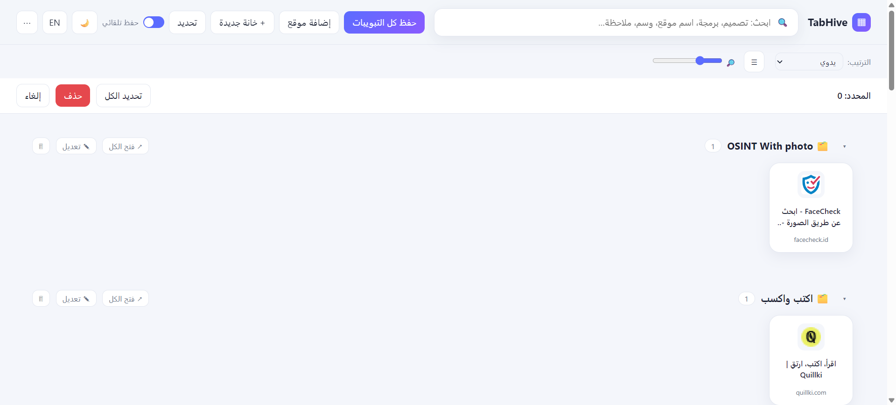
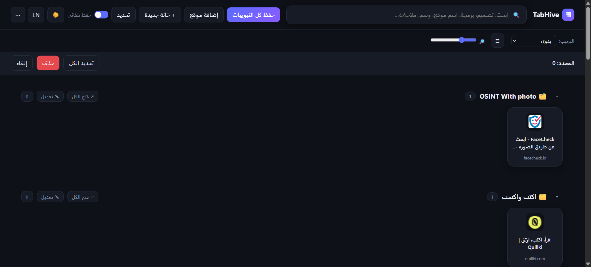

<div align="center">


# TabHive

### Your tabs are a mess. Fix it once.

**Save every open tab, auto-sort them into smart groups, and find anything in a keystroke.**
Works on Chrome, Edge, Brave, Opera, Vivaldi, and Firefox. No account. No cloud. Fully local.

[](LICENSE)


[**English**](README.md) · [**العربية**](README.ar.md)

[Install](#-install-in-60-seconds) · [Features](#-features) · [Shortcuts](#-keyboard-shortcuts--right-click) · [Privacy](#-privacy--permissions) · [Roadmap](#-roadmap) · [Contributing](#-contributing)

</div>

---

## The problem

You've got 47 tabs open. Half of them are "I'll read this later." A quarter are documentation you needed last Tuesday. Somewhere in there is the one design reference you swore you'd never lose.

Then the browser crashes, or you restart your machine, or you just close the window by accident, and it's all gone.

Bookmarks don't fix this. Nobody files bookmarks. They pile up in a folder called "New folder (3)" and you never open them again.

## What TabHive does

TabHive turns your browser's chaos into a clean, searchable grid of every site you use, **automatically**.

- Open a site → it's saved.
- It lands in the right group (coding, design, AI, learning...) without you lifting a finger.
- Close the browser, reboot the PC, come back next week → everything is still there.
- Nothing is ever deleted unless **you** delete it, and even then it goes to a trash with an undo button.

Click the icon once and you get one fast, good-looking page with all your sites as icon tiles, grouped, searchable, draggable.

<!--
  Add your screenshots to docs/screenshots/ and they will show up here.
  Tip: one dark-mode shot, one light-mode shot, one Arabic/RTL shot, and a short GIF of drag & drop.
-->

<div align="center">

| Light | Dark |
|:--:|:--:|
|  |  |


</div>

---

## ✨ Features

### 🧠 It saves everything, so you don't have to think about it
- **Save all tabs in one click**, across every open window.
- **Auto-save** (on by default, toggle it off any time): any page you open is saved once, with its real title. Duplicates are ignored.
- **Persistent**: survives closing the browser, restarting the computer, and updating the extension.
- **Never deletes on its own.** Removal is manual only: one site, or select many and remove them together.
- **Trash + Undo**: every delete goes to a trash first. Hit **Undo** in the toast, or restore later. The trash is never emptied automatically.

### 🗂️ It organizes itself
- **Automatic categories** based on the site: Programming, Design, AI, Learning, Video, Music, Social, Work, Shopping, News. See [how it decides](#-how-auto-categorizing-works).
- **Custom groups**: rename any group, give it an emoji and a color, or create your own.
- **Drag & drop** a site from one group to another. **Drag the group header** to reorder groups.
- **Favorites row** ⭐: star a site (or drop it onto the row) to pin it at the top.
- **Most used**: TabHive counts your opens, so "Most used" sorting actually reflects your habits.
- **Read later**: a built-in group. Right-click any site → *Read later*.
- **Tags & notes** on any site, fully searchable.
- **Sort** by manual order, newest, A–Z, or most used.

### 🔍 It finds things fast
- **Instant search bar** that looks at titles, URLs, notes, tags, group names, *and category keywords*. Type `design` or `تصميم` and Figma, Canva, and Dribbble show up, even if those words aren't in their titles.
- **Quick-search popup** from *any* page with a shortcut (default **Alt+K**). Arrow keys, Enter, done.

### ⚡ It adds sites in bulk, in whatever form you have them
- Paste URLs (one per line) or bare domains.
- **Drag & drop links** straight onto the page, several at once.
- **Drag & drop an entire folder of shortcuts**, including subfolders. Supported: Windows `.lnk` (yes, really, see [the parser](#-how-it-works)), `.url`, `.webloc`, `.desktop`, `.txt`, and exported bookmark `.html` files.
- **Import your browser bookmarks**: each bookmark folder becomes a group with the same name.
- **Right-click any page or link** → *TabHive: Save* / *Read later*.

### 🪟 It opens sites like apps
- **Open as app** (⧉): launches a site in its own clean window with no tab strip.
- **Desktop shortcut** (🖥): downloads a tiny launcher that opens the site in Chrome/Edge *app mode*. See the [honest notes](#-desktop-shortcuts-the-honest-version).
- **Open all**: one click opens a whole group in the background and wraps it in a **colored tab group** named after the group (Chromium browsers).

### 🧹 It keeps itself tidy
- **Remove duplicates**: understands that `www.site.com/page` and `site.com/page/?utm_source=x` are the same page.
- **Dead-link check**: flags sites that now return 404/410, server errors, or don't resolve. The permission is only requested when you click the button.
- **Backup & restore**: export everything to JSON; import merges instead of overwriting.

### 🎨 It looks good
- Light and dark themes (follows your system on first launch).
- Full **English and Arabic** UI with proper **RTL** layout.
- Grid of icon tiles or a compact list. A slider controls tile size.
- Every site shows its own favicon, with a clean fallback letter when one isn't available.

### 🔒 It can keep things private
- **PIN-lock any group.** Locked groups disappear from the grid, favorites, search, and quick-search until you unlock them. (Read the [note on what this does and doesn't protect](#-privacy--permissions).)

---

## 🚀 Install in 60 seconds

TabHive isn't on the stores yet (see the [roadmap](#-roadmap)), so you load it directly. It takes about a minute.

```bash
git clone https://github.com/YOUR_USERNAME/tabhive.git
```

Or just download the ZIP from GitHub and unzip it. The folder with `manifest.json` in it is the extension.

### Chrome · Edge · Brave · Opera · Vivaldi
1. Open `chrome://extensions` (or `edge://extensions`, `brave://extensions`...).
2. Turn on **Developer mode**.
3. Click **Load unpacked** and select the `tabhive` folder.
4. Pin the icon to your toolbar. Click it. You're in.

### Firefox (128+)
1. Open `about:debugging#/runtime/this-firefox`.
2. Click **Load Temporary Add-on...** and pick `manifest.json`.

> **Heads up:** Firefox removes temporary add-ons when it restarts, so you'd need to reload it each session until TabHive is signed and published. Your saved data stays safe in the meantime.

### Your first 60 seconds
1. Click the TabHive icon. A page opens with your sites.
2. Hit **Save all tabs**. Watch them sort themselves into groups.
3. Press **Alt+K** from any page and search for something.
4. Drag a site into another group. Right-click one. Star one.

> 💡 **Before you update or reinstall:** use **⋯ → Export backup** first. Removing an unpacked extension from the browser can wipe its stored data.

---

## 🎯 Adding sites: every way

| You have... | Do this |
|---|---|
| Tabs open right now | **Save all tabs** (or just leave auto-save on) |
| A link | Paste it in **Add site**, or drag it onto the page |
| A pile of links | Paste them one per line, or drag them all at once |
| A folder of shortcuts | Drag the whole folder in, or use **Add site → Choose a whole folder** |
| Windows `.lnk` files | Select all (`Ctrl+A`) in Explorer and drag them in |
| Browser bookmarks | **⋯ → Import browser bookmarks** (folders become groups) |
| An exported bookmarks `.html` | Drag the file in |
| A page you're reading | Right-click → **TabHive: Save** |
| An article for later | Right-click → **TabHive: Read later** |

Drop things **onto a specific group** to put them there. Drop them anywhere else and TabHive categorizes them for you. Duplicates are skipped and you get a summary like *"Added 38 sites • 2 duplicates skipped • 1 file without a URL."*

---

## ⌨️ Keyboard shortcuts & right-click

| Action | Shortcut |
|---|---|
| Quick-search popup (from any page) | **Alt+K** (Mac: **Control+K**) |
| Focus the search bar (inside TabHive) | **Ctrl/⌘ + K** |
| Move through quick-search results | **↑ / ↓**, then **Enter** |
| Close quick search | **Esc** |

You can remap the global shortcut at `chrome://extensions/shortcuts`.

**Right-click a site tile** for: Open · Open as app · Desktop shortcut · Edit · Favorite · Read later · Delete.

---

## 🧭 How auto-categorizing works

No AI, no network calls. It's a small, readable rules table in [`common.js`](common.js):

1. Check the **domain** against known sites (`github.com`, `figma.com`, `youtube.com`...). Subdomains match too.
2. If that doesn't match, check **keywords** in the title and hostname (`tutorial`, `design`, `news`, Arabic keywords too).
3. Otherwise it goes to **Other**.

| Category | Examples |
|---|---|
| 💻 Programming | GitHub, GitLab, Stack Overflow, MDN, LeetCode, CodePen |
| 🎨 Design | Figma, Canva, Dribbble, Behance, Unsplash |
| 🤖 AI | ChatGPT, Claude, Perplexity, Hugging Face |
| 🎓 Learning | Coursera, Udemy, Khan Academy, Wikipedia |
| 🎬 Video | YouTube, Netflix, Twitch |
| 🎵 Music | Spotify, SoundCloud, Anghami |
| 💬 Social | Facebook, Instagram, X, LinkedIn, Reddit, Discord |
| 🗂️ Work | Gmail, Google Docs/Drive, Notion, Trello, Slack |
| 🛒 Shopping | Amazon, eBay, AliExpress, Noon |
| 📰 News | BBC, CNN, Al Jazeera, Reuters |

Wrong guess? Just drag the site to the right group. Want a site or category supported? That's a one-line change. See [Contributing](#-contributing).

---

## 🖥 Desktop shortcuts: the honest version

Browsers don't let extensions create real desktop shortcuts directly. So the 🖥 button does the next best thing: it **downloads a tiny launcher file** that opens the site in app mode (its own window, no tabs or address bar).

| OS | File you get | Notes |
|---|---|---|
| Windows | `.bat` | Uses Chrome (or Edge if that's your browser). Move it to your Desktop. |
| macOS | `.command` | Run `chmod +x` on it once. |
| Linux | `.desktop` | Move it where your launcher expects. |

Firefox has no app mode, so the launcher only helps on Chromium browsers. The **⧉ Open as app** button works everywhere and needs no file at all.

---

## 🔐 Privacy & permissions

**Your data lives in your browser (`storage.local`).** No account, no server, no analytics, no remote code.

Two things worth knowing, stated plainly:

- 🌐 **Favicons** are loaded from Google's favicon service (`google.com/s2/favicons`), which means the *domain names* of your saved sites are sent to Google to fetch their icons. If that matters to you, see the roadmap: a local favicon cache is planned.
- 🔒 **PIN lock is a privacy screen, not encryption.** It hides a group's contents from the interface and from search. Someone who can inspect your browser profile's storage could still read the data. Don't treat it as a vault.

| Permission | Why it's needed |
|---|---|
| `tabs` | Read the URL and title of tabs so they can be saved and so the manager page can be focused |
| `storage` | Save your sites and settings locally |
| `tabGroups` | Wrap "Open all" in a colored tab group |
| `contextMenus` | The right-click *Save* / *Read later* entries |
| `bookmarks` *(optional)* | Only requested when you click **Import browser bookmarks** |
| Access to all sites *(optional)* | Only requested when you click **Check for dead links**, so the check can reach your saved URLs |

---

## 🌍 Browser support

| Browser | Status |
|---|---|
| Chrome, Edge, Brave, Opera, Vivaldi | ✅ Full support |
| Firefox 128+ | ✅ Works. No colored tab groups, no app-mode launcher, and temporary install until published |
| Safari | ❌ Needs conversion through Xcode (not done) |

---

## 🛠 How it works

Plain HTML, CSS, and JavaScript. **No build step, no framework, no dependencies.** Open the folder in your editor and start hacking.

```
tabhive/
├── manifest.json     Manifest V3 (Chromium + Firefox)
├── background.js     Service worker: auto-save, context menus, shortcut handler, new-tab option
├── common.js         Shared logic: categories, URL normalizing, storage, trash, search, .lnk parser
├── app.html/css/js   The manager page
├── quick.html/js     The Alt+K quick-search popup
└── icons/
```

A few details I'm happy with:

- **Safe writes.** Every change goes through a small serialized read-modify-write queue (`mutate()`), so the background worker and the UI don't clobber each other's saves.
- **Smart dedup.** URLs are normalized (fragments, trailing slashes, tracking params like `utm_*`/`fbclid`) before comparing.
- **A real `.lnk` parser.** Windows shortcuts are a binary format ([MS-SHLLINK](https://learn.microsoft.com/en-us/openspecs/windows_protocols/ms-shllink/)). Chrome-made site shortcuts store their URL in the *command-line arguments* field as UTF-16. TabHive reads the header flags, skips the ID list and link info, and decodes the string data properly, so dropping a folder of `.lnk` files just works.
- **Arabic-aware search.** Text is normalized (diacritics, alef/ya/ta-marbuta variants) so searching feels natural in Arabic too.

---

## ❓ FAQ

**Will it slow my browser down?**
Auto-save runs once when a page finishes loading and does nothing if the URL is already saved. The manager page is plain DOM with no framework.

**Does it save incognito tabs?**
Extensions don't run in incognito unless you explicitly allow them. If you do, treat TabHive like any other extension that can see those tabs.

**I deleted something by mistake.**
**⋯ → Trash.** Everything you delete lands there and stays until you empty it yourself.

**Where's my data stored? Can I move it to another computer?**
In your browser's local extension storage. To move it: **Export backup** on one machine, **Import backup** on the other. Importing merges, so nothing gets overwritten.

**Why does the Firefox install disappear after restart?**
That's how temporary add-ons work. A signed Firefox build is on the roadmap.

**Can it sync between devices?**
Not built in. Browser sync storage is too small for a real library, and cloud sync needs accounts and OAuth, which cuts against the "no account" goal. For now: export to a folder that you already sync (Drive, OneDrive, Dropbox) and import on the other device.

---

## 🗺 Roadmap

- [x] Auto-save, smart groups, drag & drop
- [x] Search, quick-search popup, shortcuts
- [x] Trash/undo, backup/restore, duplicate cleaner, dead-link check
- [x] Favorites, tags, notes, read later, PIN lock
- [x] Bulk import: folders, `.lnk`, `.url`, bookmarks
- [x] English + Arabic with RTL
- [ ] Local favicon cache (no third-party requests)
- [ ] Publish to the Chrome Web Store and Firefox Add-ons
- [ ] Automated tests and CI
- [ ] User-defined category rules
- [ ] Optional encrypted export/lock
- [ ] More UI languages
- [ ] Import from Pocket / Raindrop / OneTab exports

Have an idea? [Open an issue](../../issues). The best ones usually come from real daily pain.

---

## 🤝 Contributing

Contributions are very welcome, and some of the best ones are tiny:

- **Add a site to a category**: edit the `d` (domains) list in `CATS` in `common.js`. One line.
- **Add keywords** (any language) to a category's `k` list.
- **Translate the UI**: copy the `en` block in `T` at the top of `app.js` and translate the strings.
- **Fix a bug / build a roadmap item**: fork, branch, hack, open a PR.

Local dev loop: load the folder unpacked, edit, hit the reload icon on `chrome://extensions`. That's it.

Please keep the project dependency-free and the privacy story simple.

---

## 📄 License

[MIT](LICENSE). Use it, fork it, ship it.

---

<div align="center">

**If TabHive saved you from one lost tab, a ⭐ helps others find it.**

Built because 47 open tabs is not a personal organization system.

</div>
